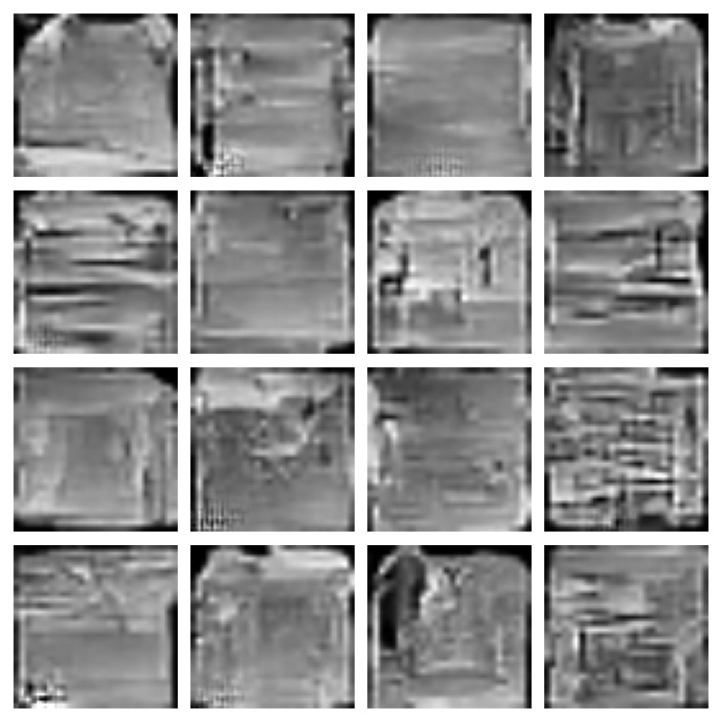
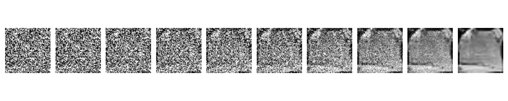

# DDPM from scratch

I wanted to understand how diffusion models turn random noise into images, so I built a DDPM (Denoising Diffusion Probabilistic Model) in PyTorch, following [DeepFindr's tutorial](https://www.youtube.com/watch?v=a4Yfz2FxXiY).

It learns to predict the noise added to Fashion-MNIST images. To generate something new, it starts with random noise and removes it over 200 steps.

**Trained for 10 epochs.** The code was set to 100, but I wasn't waiting around 8 hours for the whole thing lol. These are the samples from that shorter run:



They're blurry, and some are still hard to make out. You can see clothing shapes starting to appear, though. For now, I'm happy to have the whole process working.

Here's one image going from noise to a clothing shape:



The model uses a U-Net with skip connections, sinusoidal timestep embeddings, a linear noise schedule, and L1 noise prediction loss. Images are resized to 64×64, with a batch size of 128. CUDA is selected automatically when available, with mixed precision to reduce GPU memory use.

I ran it on an **RTX 3060 Laptop GPU with 6 GB VRAM**.

To try it, install `torch` and `torchvision` using the [PyTorch installer](https://pytorch.org/get-started/locally/)—choose a CUDA build for NVIDIA GPU training—then run:

```bash
pip install matplotlib
python ddpm_scratch.py
```

Fashion-MNIST downloads automatically. Set `EPOCHS = 10` in `ddpm_scratch.py` for the same training budget as this run; the code still defaults to 100.

Weights are saved to `ddpm_model.pth` after every epoch. To generate 16 images from your saved weights:

```bash
python sample.py
```

This saves `generated_images.png` and `reverse_diffusion.png`, replacing the previous images. It generates random clothing items; there is no category selection.

Weights and the dataset are excluded from Git, so you'll need to train before sampling. Running the training script again starts a new run; it doesn't automatically resume from saved weights.
